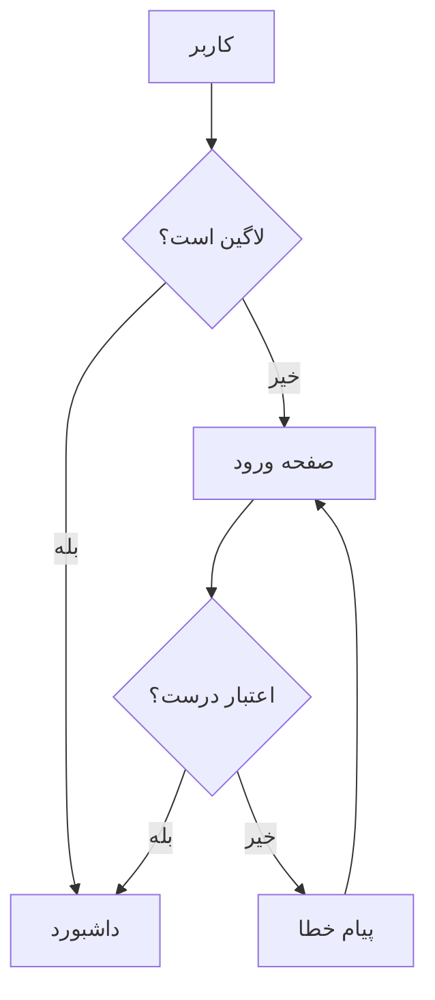
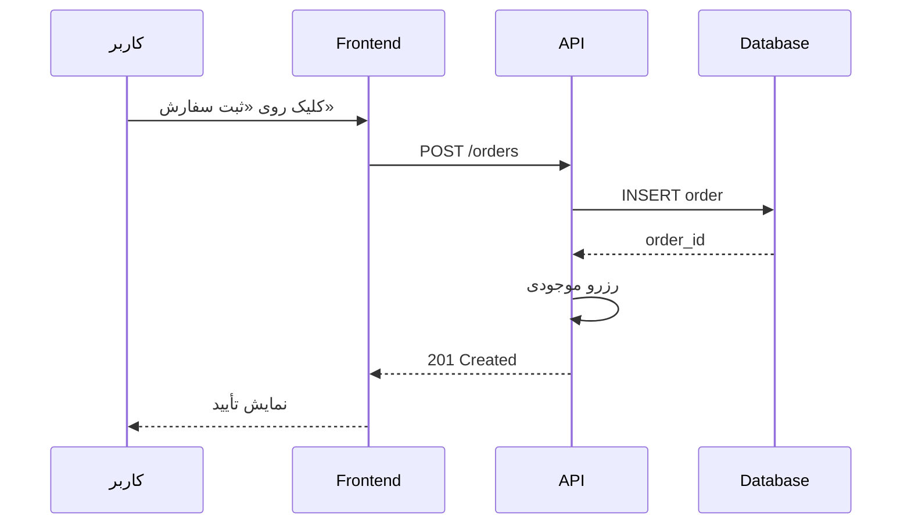
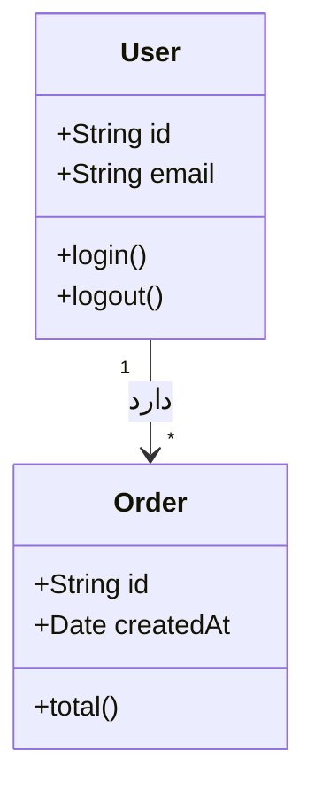
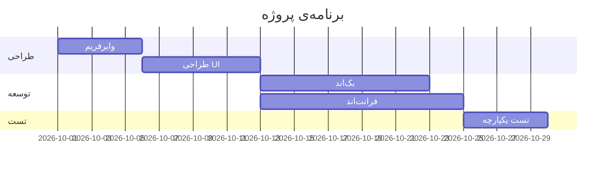

# بخش ۰۶: ساختار مخزن حرفه‌ای

**مدت یادگیری**: ۳ تا ۴ ساعت
**سطح سختی**: مبتدی
**پیش‌نیاز**: بخش ۰۲ (commit، ignore)

---

## فهرست محتوا

- [فصل ۲۵: آناتومی یک مخزن حرفه‌ای — README، LICENSE، CONTRIBUTING، SECURITY](#فصل-۲۵)
- [فصل ۲۶: قالب‌ها — Issue، PR، CODEOWNERS، FUNDING](#فصل-۲۶)
- [فصل ۲۷: Markdown در GitHub — از README تا Mermaid و alert](#فصل-۲۷)
- [فصل ۲۸: تنظیمات مخزن — visibility، topics، archive، transfer](#فصل-۲۸)

---

## فصل ۲۵: آناتومی یک مخزن حرفه‌ای — README، LICENSE، CONTRIBUTING، SECURITY

### مقدمه

یک مخزن خوب با یک مخزن بد تفاوتش در کد نیست، در **قابلیت فهمیدن**. کسی که برای اولین بار مخزن تو را می‌بیند، در ۳۰ ثانیه تصمیم می‌گیرد: «این به کارم می‌آید یا نه؟»

**چرا مهم است؟** برای پروژه‌های متن‌باز، README خوب = مشارکت‌کننده بیشتر. برای پروژه‌های شرکتی، مستندات خوب = onboarding سریع‌تر. برای خودت، شش ماه بعد، یادت نمی‌آید چطور اجرا می‌شد.

**کاربرد عملی:** این فصل یک چک‌لیست عملی است: ۵ فایلی که هر مخزن باید داشته باشد، و اینکه در هر کدام چه بنویسی.

### مفاهیم اساسی

#### فایل‌های ضروری

| فایل | برای چه | الزامی؟ |
|---|---|---|
| `README.md` | این پروژه چیست، چطور اجرا شود | ✅ همیشه |
| `LICENSE` | حقوق استفاده | ✅ برای عمومی |
| `CONTRIBUTING.md` | چطور مشارکت کنم | ✅ برای تیمی/متن‌باز |
| `SECURITY.md` | چطور آسیب‌پذیری گزارش کنم | ✅ برای عمومی |
| `CODE_OF_CONDUCT.md` | قواعد رفتار | توصیه‌شده برای متن‌باز |
| `CHANGELOG.md` | تاریخ تغییرات | توصیه‌شده |
| `.gitignore` | فایل‌های نادیده | ✅ همیشه |

#### فایل‌های اختیاری ولی مفید

| فایل | برای چه |
|---|---|
| `.editorconfig` | تنظیمات ادیتور مشترک |
| `.gitattributes` | رفتار Git روی فایل‌ها |
| `ARCHITECTURE.md` | توضیح ساختار کد |
| `ROADMAP.md` | برنامه‌ی آینده |
| `SUPPORT.md` | چطور کمک بگیرم |
| `FUNDING.yml` | حمایت مالی |
| `.github/` | همه‌ی تنظیمات GitHub |

#### پوشه‌ی `.github/` — قلب تنظیمات

```
.github/
├── workflows/              ← Actions (فصل ۴۲)
├── ISSUE_TEMPLATE/
│   ├── bug_report.yml
│   ├── feature_request.yml
│   └── config.yml
├── PULL_REQUEST_TEMPLATE.md
├── CODEOWNERS
├── dependabot.yml          ← فصل ۷۱
├── SECURITY.md
├── FUNDING.yml
├── copilot-instructions.md ← فصل ۶۹
└── DISCUSSION_TEMPLATE/
```

### مثال‌های عملی

#### مثال ۱: README کامل

````markdown
# نام پروژه

> یک جمله که می‌گوید این پروژه چه کاری می‌کند.

[](https://github.com/USER/REPO/actions/workflows/ci.yml)
[](LICENSE)
[](https://www.npmjs.com/package/package-name)

## درباره

دو-سه پاراگراف: مسئله چیست، این پروژه چطور حلش می‌کند، برای چه کسی است.

## نصب

```bash
npm install package-name
```

## استفاده‌ی سریع

```javascript
import { createServer } from "package-name";

const server = createServer({ port: 3000 });
await server.start();
```

## مستندات

- [شروع سریع](docs/quickstart.md)
- [API](docs/api.md)
- [مثال‌ها](examples/)

## توسعه

```bash
git clone https://github.com/USER/REPO.git
cd REPO
npm install
npm test
```

## مشارکت

از [CONTRIBUTING.md](CONTRIBUTING.md) شروع کن.

## لایسنس

[MIT](LICENSE)
````

**قواعد README خوب:**

1. **یک جمله‌ی توضیح در بالا** — کسی که فقط عنوان را می‌بیند، باید بفهمد.
2. **badge** — وضعیت CI، نسخه، لایسنس. اعتماد می‌سازد.
3. **نصب در ۳ خط** — اگر بیشتر شد، خیلی پیچیده است.
4. **مثال قابل کپی** — نه «API را ببینید»، بلکه یک نمونه‌ی کامل.
5. **اسکرین‌شات یا GIF** برای پروژه‌های UI.

#### مثال ۲: LICENSE — کدام؟

| لایسنس | می‌توانند استفاده تجاری کنند؟ | باید کد را باز کنند؟ | مناسب برای |
|---|---|---|---|
| **MIT** | ✅ | ❌ | اکثر پروژه‌ها، ساده‌ترین |
| **Apache 2.0** | ✅ | ❌ | پروژه‌های شرکتی (patent grant) |
| **GPL v3** | ✅ | ✅ (اگر توزیع کنی) | نرم‌افزار آزاد |
| **AGPL v3** | ✅ | ✅ (حتی SaaS) | جلوگیری از استفاده‌ی ابری بدون بازکردن کد |
| **BSD-3** | ✅ | ❌ | شبیه MIT |
| **Unlicense** | ✅ | ❌ | public domain |

**نکته‌ی حیاتی:** بدون LICENSE، از نظر حقوقی **هیچ‌کس اجازه‌ی استفاده ندارد** — حتی اگر مخزن عمومی باشد. «public» یعنی «می‌شود دید»، نه «می‌شود استفاده کرد».

```bash
# GitHub خودش موقع ساخت مخزن می‌گذارد
# یا:
gh api -X POST repos/OWNER/REPO/license -f license_template=mit
```

#### مثال ۳: CONTRIBUTING.md

```markdown
# راهنمای مشارکت

## قبل از شروع
- برای تغییرات بزرگ، اول یک Issue باز کن و توضیح بده.
- `CONTRIBUTING` را کامل بخوان.

## راه‌اندازی محیط
```bash
git clone https://github.com/USER/REPO.git
cd REPO
npm install
npm run dev
```

## استراتژی شاخه
- از `main` branch بساز: `feat/<توضیح>`، `fix/<توضیح>`، `docs/<توضیح>`
- نام branch حداکثر ۵۰ کاراکتر

## پیام commit
Conventional Commits الزامی است:
```
feat(scope): توضیح
fix(scope): توضیح
docs: توضیح
```

## قبل از PR
```bash
npm run lint
npm test
npm run build
```

## قواعد PR
- حداکثر ۴۰۰ خط تغییر
- تست برای هر ویژگی جدید
- توضیح «چرا»، نه فقط «چه»
- یک reviewer حداقل

## Code Review
- ۴۸ ساعت مهلت review
- اگر ۵ روز بی‌جواب ماند، در PR کامنت بزن

## رفتار
[CODE_OF_CONDUCT.md](CODE_OF_CONDUCT.md) را رعایت کن.
```

#### مثال ۴: SECURITY.md

```markdown
# سیاست امنیتی

## نسخه‌های پشتیبانی‌شده

| نسخه | پشتیبانی |
|---|---|
| 2.x | ✅ |
| 1.x | ❌ |

## گزارش آسیب‌پذیری

**آسیب‌پذیری را در Issue عمومی گزارش نکن.**

از یکی از این راه‌ها استفاده کن:

1. **Private vulnerability reporting** (توصیه‌شده):
   https://github.com/USER/REPO/security/advisories/new
2. ایمیل: security@example.com (PGP: [کلید](key.asc))

## چه چیزی را شامل کن
- توضیح آسیب‌پذیری
- مراحل بازتولید
- نسخه‌ی تحت تأثیر
- اثر احتمالی
- پیشنهاد fix (اختیاری)

## زمان‌بندی
- تأیید دریافت: ۴۸ ساعت
- ارزیابی اولیه: ۵ روز
- fix: بسته به شدت (Critical: ۷ روز)

## قدردانی
ما در release notes از گزارش‌دهنده تشکر می‌کنیم (مگر اینکه ناشناس بخواهد).
```

**نکته:** GitHub یک قابلیت **Private vulnerability reporting** دارد که در **Settings → Code security** فعال می‌شود. بدون آن، گزارش‌دهنده مجبور است Issue عمومی بزند — که یعنی آسیب‌پذیری برای همه آشکار می‌شود.

#### مثال ۵: `.editorconfig`

```ini
root = true

[*]
charset = utf-8
end_of_line = lf
insert_final_newline = true
trim_trailing_whitespace = true
indent_style = space
indent_size = 2

[*.py]
indent_size = 4

[*.md]
trim_trailing_whitespace = false

[Makefile]
indent_style = tab
```

این فایل جلوی جنگ «tab یا space» را می‌گیرد و اکثر ادیتورها پشتیبانی می‌کنند.

### مقایسه و الگوهای مختلف

#### README مینیمال در برابر کامل

| | مینیمال | کامل |
|---|---|---|
| طول | ۲۰ خط | ۲۰۰ خط |
| مناسب | کتابخانه‌ی کوچک | محصول |
| خطر | مشارکت‌کننده گیج می‌شود | کسی تا آخر نمی‌خواند |

**راه‌حل:** README کوتاه و واضح + پوشه‌ی `docs/` برای جزئیات. README = ویترین، docs = انبار.

#### LICENSE: MIT در برابر Apache

| | MIT | Apache 2.0 |
|---|---|---|
| سادگی | خیلی ساده | پیچیده‌تر |
| patent grant | ❌ | ✅ |
| trademark | اشاره نمی‌کند | صریح |
| مناسب | پروژه‌های کوچک/عمومی | پروژه‌های شرکتی |

اگر شرکتت وکیل دارد، Apache 2.0 انتخاب امن‌تری است (محافظت patent صریح).

### اشکال شایع

#### ۱. README که فقط اسم پروژه است

```
✗ # my-project
```

بدون توضیح، بدون نصب، بدون مثال. هیچ‌کس نمی‌فهمد چیست.

#### ۲. بدون LICENSE در مخزن عمومی

حقوقاً هیچ‌کس نمی‌تواند استفاده کند. بعضی شرکت‌ها به‌خاطر این، پروژه‌های متن‌باز را رد می‌کنند.

#### ۳. README با دستورهای قدیمی

```
✗ npm install   (ولی پروژه به pnpm مهاجرت کرده)
```

مستندات کهنه، بدتر از نبود مستندات است.

#### ۴. SECURITY.md بدون راه ارتباطی واقعی

اگر ایمیل `security@example.com` وجود نداشته باشد، گزارش‌دهنده گیر می‌کند. Private vulnerability reporting را روشن کن.

#### ۵. CONTRIBUTING.md که اجرا نمی‌شود

اگر می‌گویی `npm test` باید پاس شود، باید واقعاً پاس شود. وگرنه اعتماد از بین می‌رود.

#### ۶. فایل‌های boilerplate بدون customization

`CONTRIBUTING.md` که اسم پروژه‌ی دیگری در آن است — نشانه‌ی بی‌دقتی.

### نکات مهم (Tips & Tricks)

- **README را آخر بنویس، نه اول.** بعد از اینکه پروژه کار کرد، بفهم چه چیزی مهم است.
- **مثال اجرایی در README بگذار** — بیشتر از توضیح کار می‌کند.
- **`docs/` برای مستندات طولانی، README برای شروع.**
- **GitHub خودش موقع ساخت مخزن می‌تواند LICENSE، .gitignore و README بگذارد.** از این شروع کن.
- **badgeها را کم نگه دار.** ۵ badge کافی است؛ ۱۵ badge شلوغی است.
- **در README بنویس «چه چیزی این پروژه نیست»** — جلوی انتظار اشتباه را می‌گیرد.

### خلاصه فصل

- پنج فایل ضروری: `README`، `LICENSE`، `CONTRIBUTING`، `SECURITY`، `.gitignore`.
- **بدون LICENSE، استفاده حقوقاً ممنوع است.**
- README: یک جمله + نصب + مثال + لینک به docs.
- `SECURITY.md` + Private vulnerability reporting = افشای مسئولانه.
- پوشه‌ی `.github/` محل همه‌ی تنظیمات است.

**سؤالات مروری:**
1. چرا مخزن عمومی بدون LICENSE قابل استفاده نیست؟
2. تفاوت MIT و Apache 2.0 در چیست؟
3. چرا SECURITY.md بدون کانال واقعی مضر است؟

---

## فصل ۲۶: قالب‌ها — Issue، PR، CODEOWNERS، FUNDING

### مقدمه

قالب‌ها (templates) کار تکراری را حذف می‌کنند و کیفیت ورودی را بالا می‌برند. یک Issue template خوب، ۸۰٪ Issueهای «کار نمی‌کند» را به گزارش‌های قابل اقدام تبدیل می‌کند.

**چرا مهم است؟** بدون قالب، هر Issue شکل متفاوتی دارد: یکی می‌نویسد «خراب است»، یکی ۵۰۰ خط لاگ می‌فرستد. با قالب، همه حداقل اطلاعات لازم را می‌دهند.

**کاربرد عملی:** یک بار تنظیم می‌کنی، سال‌ها سود می‌بری.

### مفاهیم اساسی

#### انواع قالب

| قالب | مسیر | کار |
|---|---|---|
| Issue (YAML) | `.github/ISSUE_TEMPLATE/*.yml` | فرم تعاملی |
| Issue (Markdown) | `.github/ISSUE_TEMPLATE/*.md` | متن ساده |
| Issue config | `.github/ISSUE_TEMPLATE/config.yml` | لینک‌های کمکی |
| PR | `.github/PULL_REQUEST_TEMPLATE.md` یا `pull_request_template.md` | متن پیش‌فرض PR |
| PR چندگانه | `.github/PULL_REQUEST_TEMPLATE/*.md` | انتخاب از query string |
| Discussion | `.github/DISCUSSION_TEMPLATE/*.yml` | قالب گفت‌وگو |
| CODEOWNERS | `.github/CODEOWNERS` | تعیین reviewer خودکار |

#### Issue Forms در برابر Markdown template

| | YAML (Forms) | Markdown |
|---|---|---|
| فرم تعاملی | ✅ | ❌ |
| فیلد اجباری | ✅ | ❌ |
| dropdown/checkbox | ✅ | ❌ |
| اعتبارسنجی | ✅ | ❌ |
| سادگی نوشتن | متوسط | ساده |
| توصیه | ✅ برای پروژه‌های فعال | برای ساده |

### مثال‌های عملی

#### مثال ۱: Issue Form برای باگ

`.github/ISSUE_TEMPLATE/bug_report.yml`:

```yaml
name: گزارش باگ
description: چیزی درست کار نمی‌کند
title: "[Bug]: "
labels: ["bug", "triage"]
assignees: []

body:
  - type: markdown
    attributes:
      value: |
        ممنون که وقت گذاشتی! لطفاً فرم را کامل پر کن.

  - type: checkboxes
    id: preflight
    attributes:
      label: بررسی‌های اولیه
      options:
        - label: در Issueهای موجود جست‌وجو کردم
          required: true
        - label: آخرین نسخه را استفاده می‌کنم
          required: true

  - type: textarea
    id: what-happened
    attributes:
      label: چه اتفاقی افتاد؟
      description: رفتار فعلی و رفتار مورد انتظار
      placeholder: "وقتی روی دکمه‌ی پرداخت کلیک می‌کنم، صفحه سفید می‌شود. انتظار داشتم به درگاه برود."
    validations:
      required: true

  - type: textarea
    id: steps
    attributes:
      label: مراحل بازتولید
      placeholder: |
        1. وارد شوید
        2. سبد خرید را پر کنید
        3. روی «پرداخت» بزنید
    validations:
      required: true

  - type: textarea
    id: logs
    attributes:
      label: لاگ یا پیام خطا
      render: shell
    validations:
      required: false

  - type: input
    id: version
    attributes:
      label: نسخه
      placeholder: "2.3.1"
    validations:
      required: true

  - type: dropdown
    id: os
    attributes:
      label: سیستم‌عامل
      options:
        - Windows 11
        - macOS
        - Ubuntu
        - سایر
    validations:
      required: true

  - type: textarea
    id: context
    attributes:
      label: اطلاعات بیشتر
      description: اسکرین‌شات، ویدیو، هر چیزی که کمک کند
    validations:
      required: false
```

#### مثال ۲: Issue Form برای درخواست ویژگی

`.github/ISSUE_TEMPLATE/feature_request.yml`:

```yaml
name: درخواست ویژگی
description: ایده‌ای برای بهبود پروژه
title: "[Feature]: "
labels: ["enhancement"]

body:
  - type: textarea
    id: problem
    attributes:
      label: چه مشکلی داری؟
      description: به‌جای راه‌حل، مسئله را توضیح بده
      placeholder: "وقتی گزارش ماهانه می‌گیرم، باید دستی تاریخ‌ها را وارد کنم."
    validations:
      required: true

  - type: textarea
    id: solution
    attributes:
      label: راه‌حل پیشنهادی
    validations:
      required: true

  - type: textarea
    id: alternatives
    attributes:
      label: جایگزین‌هایی که بررسی کردی
    validations:
      required: false

  - type: dropdown
    id: priority
    attributes:
      label: اولویت از دید تو
      options:
        - خیلی مهم
        - مهم
        - خوب است داشته باشیم
    validations:
      required: false
```

#### مثال ۳: `config.yml` — هدایت به جای Issue

`.github/ISSUE_TEMPLATE/config.yml`:

```yaml
blank_issues_enabled: false
contact_links:
  - name: سؤال و پشتیبانی
    url: https://github.com/USER/REPO/discussions/categories/q-a
    about: لطفاً سؤال‌ها را در Discussions بپرس، نه در Issues
  - name: مستندات
    url: https://docs.example.com
    about: شاید جواب سؤالت اینجا باشد
  - name: گزارش آسیب‌پذیری
    url: https://github.com/USER/REPO/security/advisories/new
    about: آسیب‌پذیری را عمومی گزارش نکن
```

`blank_issues_enabled: false` جلوی Issueهای بی‌قالب را می‌گیرد — ولی بعضی پروژه‌ها آن را باز می‌گذارند تا مشارکت‌کننده اذیت نشود.

#### مثال ۴: PR Template

`.github/PULL_REQUEST_TEMPLATE.md`:

```markdown
## توضیح

<!-- این PR چه کاری می‌کند و چرا؟ -->

## نوع تغییر

- [ ] رفع باگ (fix)
- [ ] ویژگی جدید (feat)
- [ ] تغییر ناسازگار (breaking change)
- [ ] بازآرایی (refactor)
- [ ] مستندات (docs)
- [ ] CI/ابزار (chore)

## چک‌لیست

- [ ] تست‌ها اضافه یا به‌روز شدند
- [ ] `npm run lint` پاس شد
- [ ] `npm test` پاس شد
- [ ] مستندات به‌روز شد
- [ ] خودم diff را کامل خواندم
- [ ] نام branch و پیام commit با قواعد پروژه می‌خواند

## اسکرین‌شات (اگر تغییر ظاهری است)

| قبل | بعد |
|---|---|
|  |  |

## Issue مرتبط

Closes #

## نکات برای reviewer

<!-- از کجا شروع کند؟ چه چیزی را نادیده بگیرد؟ -->
```

#### مثال ۵: CODEOWNERS

`.github/CODEOWNERS`:

```gitignore
# پیش‌فرض: تیم اصلی
*                       @myorg/core-team

# مسیرهای خاص
/docs/                  @myorg/docs-team
/frontend/              @myorg/frontend-team
/backend/api/           @ali @maryam
/infra/                 @myorg/platform-team

# فایل‌های حساس — همه باید تأیید کنند
/.github/workflows/     @myorg/core-team @myorg/security-team
/db/migrations/         @myorg/dba-team
*.sql                   @myorg/dba-team

# فایل‌های امنیتی
SECURITY.md             @myorg/security-team
```

**قواعد:**

- الگوها مثل `.gitignore` کار می‌کنند.
- آخرین الگوی منطبق برنده است (برخلاف `.gitignore` که ترتیب مهم است — اینجا هم ترتیب مهم است، از پایین به بالا اولویت).
- `@username` یا `@org/team`.
- با `*` می‌توانی default بدهی.

**نکته:** CODEOWNERS به‌تنهایی review را اجباری نمی‌کند. باید در Ruleset، گزینه‌ی **Require review from Code Owners** روشن باشد (فصل ۳۹).

#### مثال ۶: FUNDING.yml

`.github/FUNDING.yml`:

```yaml
github: [ali]
patreon: ali_dev
open_collective: my-project
ko_fi: alidev
tidelift: npm/my-package
custom: ["https://example.com/donate"]
```

بعد از اضافه کردن، یک دکمه‌ی **Sponsor** در صفحه‌ی مخزن ظاهر می‌شود.

#### مثال ۷: چند PR template

```
.github/PULL_REQUEST_TEMPLATE/
├── bugfix.md
├── feature.md
└── release.md
```

استفاده:

```
https://github.com/USER/REPO/compare/main...feat/x?template=feature.md
```

### مقایسه و الگوهای مختلف

#### `blank_issues_enabled`

| مقدار | رفتار | مناسب |
|---|---|---|
| `true` (پیش‌فرض) | Issue خالی هم می‌شود ساخت | پروژه‌های باز |
| `false` | فقط قالب‌ها | پروژه‌های با Issue زیاد |

#### CODEOWNERS: تیم در برابر فرد

| | `@org/team` | `@username` |
|---|---|---|
| وقتی کسی می‌رود | تیم می‌ماند | review می‌شکند |
| نگهداری | آسان | سخت |
| توصیه | ✅ | فقط برای مالکیت شخصی |

### اشکال شایع

#### ۱. YAML قالب خطا دارد

Issue Forms با YAML نامعتبر کار نمی‌کند و خطا هم واضح نیست. از linter استفاده کن یا با یک قالب ساده شروع کن.

#### ۲. `required: true` برای همه‌چیز

اگر ۸ فیلد اجباری بگذاری، مشارکت‌کننده بی‌خیال می‌شود. فقط ۲-۳ فیلد واقعاً حیاتی را اجباری کن.

#### ۳. CODEOWNERS با مسیر اشتباه

مسیرها نسبت به ریشه‌ی مخزن هستند. `docs/` درست است، `./docs/` نه.

#### ۴. CODEOWNERS بدون Ruleset

بدون **Require review from Code Owners**، فقط یک اطلاع است، نه اجبار.

#### ۵. PR template خیلی طولانی

اگر ۵۰ خط چک‌لیست داشته باشد، همه بدون خواندن رد می‌کنند. حداکثر ۱۵ خط.

#### ۶. Issue template که در مخزن‌های خصوصی کار نمی‌کند

کار می‌کند — ولی اگر مخزن از organization ارث می‌برد، ممکن است قالب سازمانی اولویت داشته باشد.

### نکات مهم (Tips & Tricks)

- **با یک قالب شروع کن، بعد اضافه کن.** ۴ قالب از روز اول، اضافه‌کاری است.
- **در `bug_report`، `render: shell`** برای بلوک لاگ — خواناتر می‌شود.
- **`config.yml` با `contact_links`** حجم Issueهای غیرمرتبط را نصف می‌کند.
- **CODEOWNERS را با Ruleset ترکیب کن** تا واقعاً اجباری شود.
- **PR template را در تیم بحث کن** — قالب تحمیلی رعایت نمی‌شود.
- **GitHub خودش موقع ساخت Issue، قالب را پیشنهاد می‌دهد** — لازم نیست جایی لینک بدهی.

### خلاصه فصل

- Issue Forms (YAML) بهتر از Markdown: فرم، اعتبارسنجی، فیلد اجباری.
- `config.yml` با `blank_issues_enabled: false` و `contact_links` جریان Issue را هدایت می‌کند.
- PR template کیفیت توضیح PR را بالا می‌برد.
- CODEOWNERS reviewer را خودکار تعیین می‌کند — با Ruleset اجباری‌اش کن.
- FUNDING.yml دکمه‌ی Sponsor اضافه می‌کند.

**سؤالات مروری:**
1. چرا Issue Form بهتر از Markdown template است؟
2. CODEOWNERS به‌تنهایی چه کم دارد؟
3. چطور جلوی Issueهای بی‌قالب را بگیری؟

---

## فصل ۲۷: Markdown در GitHub — از README تا Mermaid و alert

### مقدمه

GitHub Markdown استاندارد Markdown است به‌علاوه‌ی چند قابلیت اختصاصی: alertها، دیاگرام Mermaid، ریاضی، ارجاع به Issue، task list، و syntax highlighting. اگر اینها را بلد باشی، مستنداتت از یک متن ساده به یک تجربه‌ی خواندنی تبدیل می‌شود.

**چرا مهم است؟** README اولین چیزی است که دیده می‌شود. یک README با ساختار خوب، جدول، و دیاگرام، حرفه‌ای به نظر می‌رسد. یک دیوار متن، حتی اگر محتوایش خوب باشد، خوانده نمی‌شود.

**کاربرد عملی:** همه‌ی مستندات، Issue، PR، Discussions، Wiki و کامنت‌ها Markdown هستند. یاد گرفتن یک بار، همه‌جا کار می‌کند.

### مفاهیم اساسی

#### Markdown پایه (یادآوری سریع)

```markdown
# H1
## H2

**bold**  *italic*  ~~strike~~  `code`

- لیست
  - تودرتو

1. شماره‌دار

[لینک](https://example.com)


> نقل‌قول

| ستون | ستون |
|---|---|
| سلول | سلول |

```python
print("code block")
```

- [ ] کار انجام‌نشده
- [x] کار انجام‌شده
```

#### قابلیت‌های اختصاصی GitHub

| قابلیت | نمونه |
|---|---|
| **Alert** | `> [!NOTE]`، `> [!TIP]`، `> [!WARNING]`، `> [!IMPORTANT]`، `> [!CAUTION]` |
| **Mermaid** | ` ```mermaid ` |
| **ریاضی** | `$inline$` و `$$block$$` |
| **ارجاع** | `#42`، `@user`، `commit-hash` |
| **Task list** | `- [ ]` |
| **Footnote** | `[^1]` |
| **Collapsible** | `<details><summary>` |
| **رنگ** | `` `#0969da` `` نمایش رنگ |
| **دیاگرام GeoJSON/Topojson** | ` ```geojson ` |

### مثال‌های عملی

#### مثال ۱: Alertها

```markdown
> [!NOTE]
> اطلاعات مفید که کاربر باید بداند.

> [!TIP]
> پیشنهاد برای کار بهتر.

> [!IMPORTANT]
> اطلاعاتی که برای رسیدن به هدف لازم است.

> [!WARNING]
> چیزی که نیاز به توجه فوری دارد.

> [!CAUTION]
> ریسک از دست دادن داده یا پیامد منفی.
```

نتیجه: بلوک‌های رنگی با آیکون.

#### مثال ۲: Mermaid — فلوچارت

````markdown

````

#### مثال ۳: Mermaid — نمودار توالی

````markdown

````

#### مثال ۴: Mermaid — نمودار کلاس

````markdown

````

#### مثال ۵: Mermaid — گانت

````markdown

````

#### مثال ۶: ریاضی

```markdown
هزینه‌ی نهایی با فرمول زیر محاسبه می‌شود:

$$
C = \sum_{i=1}^{n} p_i \cdot q_i \cdot (1 - d)
$$

که در آن $p_i$ قیمت واحد و $d$ تخفیف است.
```

#### مثال ۷: بخش تاشو

```markdown
<details>
<summary>لاگ کامل خطا (کلیک کنید)</summary>

```
Error: ECONNREFUSED 127.0.0.1:5432
    at TCPConnectWrap.afterConnect
    ...
```

</details>
```

برای لاگ‌های طولانی در Issue عالی است.

#### مثال ۸: ارجاع‌های خودکار

```markdown
این باگ در #42 گزارش شده و @maryam-ahmadi روی آن کار می‌کند.
fix در commit a1b2c3d است.

بسته شد با #57.
```

GitHub خودش لینک می‌دهد و عنوان را نشان می‌دهد.

#### مثال ۹: جدول با ترازبندی

```markdown
| چپ | وسط | راست |
|:---|:---:|---:|
| a | b | c |
| متن بلندتر | x | ۱۲۳ |
```

#### مثال ۱۰: badge

```markdown


```

### مقایسه و الگوهای مختلف

#### Markdown در برابر MDX/AsciiDoc

| | Markdown | MDX | AsciiDoc |
|---|---|---|---|
| سادگی | ✅ | متوسط | متوسط |
| پشتیبانی GitHub | کامل | ❌ (نیاز به build) | ❌ |
| کامپوننت React | ❌ | ✅ | ❌ |
| مناسب | همه‌جا در GitHub | سایت مستندات | مستندات فنی پیچیده |

#### ابزارهای دیاگرام

| ابزار | در GitHub | نیاز به ابزار خارجی |
|---|---|---|
| **Mermaid** | ✅ بومی | ❌ |
| PlantUML | ❌ | ✅ (یا Action) |
| draw.io | ❌ (تصویر) | ✅ |
| Excalidraw | ❌ (تصویر) | ✅ |

Mermaid تنها دیاگرام متنی است که GitHub مستقیم رندر می‌کند — پس بهترین انتخاب برای مستندات درون‌مخزنی.

### اشکال شایع

#### ۱. Mermaid رندر نمی‌شود

- syntax خطا دارد (اغلب یک `;` یا `:` جاافتاده)
- از قابلیتی استفاده کردی که نسخه‌ی Mermaid در GitHub ندارد
- در `README.md` داخل بلوک کد چهار بک‌تیک گذاشتی و سه بک‌تیک فراموش شد

#### ۲. تصویر نمایش داده نمی‌شود

```
✗ 
✓ 
```

مسیر باید **نسبی به مخزن** باشد و فایل باید commit شده باشد.

#### ۳. لینک به heading کار نمی‌کند

anchor از heading ساخته می‌شود: `## شروع سریع` → `#شروع-سریع`. برای heading فارسی، GitHub کاراکترهای فارسی را نگه می‌دارد و فاصله‌ها را `-` می‌کند. اگر مطمئن نیستی، در VS Code با `Ctrl+Click` چک کن.

#### ۴. HTML خام کار نمی‌کند

GitHub HTML محدودی را اجازه می‌دهد (sanitized). `<script>`، `<style>`، `onclick` و اکثر event handlerها حذف می‌شوند. `<details>`، `<summary>`، `<br>`، `<kbd>`، `<sub>`، `<sup>` کار می‌کنند.

#### ۵. جدول با `|` در محتوا می‌شکند

```markdown
✗ | a | b | c |
   | x | y|z | w |    ← ستون اضافه

✓ | a | b | c |
   | x | y\|z | w |  ← escape
```

#### ۶. ریاضی رندر نمی‌شود

GitHub Math پشتیبانی می‌کند ولی نه در همه‌جا (مثلاً در کامنت Issue گاهی نه). اگر مهم است، تصویر بگذار.

### نکات مهم (Tips & Tricks)

- **Mermaid برای معماری، جریان، و توالی** — جای دیاگرام دستی را می‌گیرد و با کد تغییر می‌کند.
- **`<details>` برای لاگ‌های طولانی** — Issue را خواندنی نگه می‌دارد.
- **Alertها را کم استفاده کن.** اگر همه‌چیز `[!WARNING]` باشد، هیچ‌چیز مهم نیست.
- **جدول برای مقایسه، لیست برای مراحل، متن برای توضیح.**
- **در README، فهرست محتوا (TOC) بگذار** برای فایل‌های بلند. GitHub خودش آیکون TOC دارد (بالای فایل).
- **`kbd` برای کلیدها:** `<kbd>Ctrl</kbd> + <kbd>C</kbd>` → Ctrl + C.

### خلاصه فصل

- GitHub Markdown = Markdown + alert + Mermaid + ریاضی + ارجاع خودکار.
- **Mermaid** تنها دیاگرام متنی است که GitHub رندر می‌کند.
- `<details>` برای محتوای طولانی تاشو.
- مسیر تصاویر باید نسبی و در مخزن باشد.
- HTML محدود است (sanitized).

**سؤالات مروری:**
1. پنج نوع alert در GitHub کدام‌اند؟
2. چطور یک دیاگرام جریان در README بگذاری؟
3. چرا لینک به heading فارسی ممکن است کار نکند؟

---

## فصل ۲۸: تنظیمات مخزن — visibility، topics، archive، transfer

### مقدمه

هر مخزن ده‌ها تنظیم دارد که اکثرشان را یک بار می‌بینی و فراموش می‌کنی — تا روزی که لازم شوند: مخزن را باید به سازمان منتقل کنی، باید بایگانی کنی، باید دسترسی یک نفر را قطع کنی.

**چرا مهم است؟** تنظیم غلط می‌تواند مخزن را ناامن کند (Actions از fork بدون تأیید)، یا همکاری را غیرممکن کند (دسترسی اشتباه)، یا هزینه‌ی اضافی بسازد.

**کاربرد عملی:** این فصل یک مرور کامل تنظیمات است تا بدانی چه چیزی وجود دارد.

### مفاهیم اساسی

#### تب‌های Settings

| تب | چه چیزی |
|---|---|
| **General** | نام، توضیح، visibility، features، merge options، archive، transfer، delete |
| **Access** | Collaborators، teams، roles |
| **Branches** | Branch protection (کلاسیک) |
| **Rules** | Rulesets (فصل ۳۹) |
| **Actions** | Permissions، runners، secrets |
| **Webhooks** | اتصال به سرویس‌های خارجی |
| **Environments** | محیط‌های deploy با approval |
| **Code security** | Dependabot، Code scanning، Secret scanning |
| **Pages** | سایت استاتیک |
| **Copilot** | تنظیمات Copilot برای مخزن |

#### Visibility

| | Public | Private | Internal (Enterprise) |
|---|---|---|---|
| دیده می‌شود | همه | اعضای مجاز | همه‌ی اعضای enterprise |
| Fork | ✅ | ✅ (در org) | ✅ |
| Actions minutes | رایگان | سهمیه | سهمیه |
| Code scanning | رایگان | نیاز به Advanced Security | ✅ |

**تغییر visibility:**

- Private → Public: یک هشدار قرمز می‌دهد. **تاریخچه هم عمومی می‌شود** — اگر کلیدی در تاریخ بوده، الان عمومی است.
- Public → Private: آسان. ولی forkهای موجود عمومی می‌مانند.

#### Features

| Feature | پیش‌فرض | توضیح |
|---|---|---|
| **Issues** | ✅ | ردیابی کار |
| **Projects** | ✅ | تخته‌ها |
| **Wiki** | ❌ | مستندات سریع |
| **Discussions** | ❌ | گفت‌وگوی بلندمدت |
| **Sponsorships** | ❌ | حمایت مالی |
| **Preserve this repository** | ❌ | آرشیو در Arctic Code Vault |

#### Merge options (فصل ۱۴)

```
☑ Allow merge commits
☑ Allow squash merging
☑ Allow rebase merging
☑ Automatically delete head branches
```

#### Archive در برابر Delete

| | Archive | Delete |
|---|---|---|
| خواندن | ✅ | ❌ |
| نوشتن | ❌ | ❌ |
| بازگشت | ✅ (unarchive) | ❌ (به‌سختی) |
| مناسب | پروژه‌ی تمام‌شده | حذف کامل |

**هرگز مخزن را delete نکن** مگر مطمئن باشی. Archive کافی است.

### مثال‌های عملی

#### مثال ۱: تنظیم مخزن با gh

```bash
# توضیح و topics
gh repo edit --description "API فروشگاه با FastAPI" \
  --add-topic fastapi --add-topic ecommerce --add-topic python

# ویژگی‌ها
gh repo edit --enable-issues --enable-wiki --enable-discussions

# merge options
gh repo edit --enable-squash-merge --enable-merge-commit=false

# حذف branch بعد از merge
gh api -X PATCH repos/OWNER/REPO -F delete_branch_on_merge=true
```

#### مثال ۲: انتقال مخزن به سازمان

```bash
gh api -X POST repos/OWNER/REPO/transfer -f new_owner=myorg
```

**نکته:** بعد از transfer، URL تغییر می‌کند ولی GitHub ریدایرکت می‌گذارد. با این حال، remoteهای محلی را به‌روز کن:

```bash
git remote set-url origin git@github.com:myorg/repo.git
```

#### مثال ۳: بایگانی

```bash
gh repo archive OWNER/REPO --yes
gh repo unarchive OWNER/REPO   # بازگشت
```

#### مثال ۴: افزودن collaborator

```bash
gh api -X PUT repos/OWNER/REPO/collaborators/username -f permission=push
# permission: pull | triage | push | maintain | admin
```

#### مثال ۵: تنظیمات Actions

```bash
# فقط actions محلی و verified مجاز باشند (امنیت)
gh api -X PUT repos/OWNER/REPO/actions/permissions \
  -f enabled=true -f allowed_actions=selected

# نیاز به تأیید برای workflow از fork
gh api -X PUT repos/OWNER/REPO/actions/permissions/workflow \
  -f default_workflow_permissions=read \
  -F can_approve_pull_request_reviews=false
```

**`default_workflow_permissions=read`** یکی از مهم‌ترین تنظیمات امنیتی است: `GITHUB_TOKEN` به‌طور پیش‌فرض فقط read می‌شود. فصل ۵۲.

#### مثال ۶: topics — چرا مهم است

```
fastapi  python  ecommerce  rest-api  postgresql
```

topics در جست‌وجوی GitHub و در پیشنهادها اثر دارد. مخزن با topics مرتبط، بیشتر دیده می‌شود.

#### مثال ۷: Social preview

**Settings → General → Social preview** — تصویری که در توییتر/Slack هنگام اشتراک لینک نشان داده می‌شود. ۱۲۸۰×۶۴۰ پیکسل. تأثیر روانی زیادی دارد.

### مقایسه و الگوهای مختلف

#### Personal در برابر Organization

| | Personal | Organization |
|---|---|---|
| مالکیت | فرد | سازمان |
| اگر فرد برود | مخزن می‌ماند ولی مدیریتش مشکل | سالم |
| Teams | ❌ | ✅ |
| SSO | ❌ | ✅ (Enterprise) |
| Audit log | محدود | ✅ |
| توصیه برای شرکت | ❌ | ✅ |

#### Roles

| Role | می‌تواند |
|---|---|
| **Read** | ببیند، clone کند |
| **Triage** | Issue/PR را مدیریت کند (label، close) |
| **Write** | push کند، PR merge کند |
| **Maintain** | تنظیمات مخزن (بدون دسترسی حساس) |
| **Admin** | همه‌چیز، شامل delete |

**اصل کمترین دسترسی:** اکثر توسعه‌دهنده‌ها `Write` می‌خواهند، نه `Admin`.

### اشکال شایع

#### ۱. Private → Public بدون بررسی تاریخ

اگر روزی کلیدی commit شده و بعد پاک شده، الان **در تاریخ عمومی** است. قبل از تغییر:

```bash
git log --all -S"API_KEY" --oneline
git log --all --diff-filter=D --name-only | head -50
```

#### ۲. حذف مخزن به‌جای بایگانی

`Delete` تقریباً برگشت‌ناپذیر است (GitHub تا ۹۰ روز شاید بازیابی کند، با پشتیبانی). Archive کافی است.

#### ۳. `default_workflow_permissions` روی `write`

پیش‌فرض قدیمی `write` بود. اگر مخزن قدیمی داری، چک کن. با `read`، یک workflow آلوده نمی‌تواند کد را تغییر دهد.

#### ۴. Actions از fork بدون تأیید

```
Settings → Actions → General → Fork pull request workflows
```

گزینه‌ی **Require approval for all outside collaborators** را روشن کن. وگرنه هر کسی می‌تواند با PR، workflow تو را اجرا کند (هزینه + ریسک).

#### ۵. فراموش کردن `delete_branch_on_merge`

بعد از ۲۰۰ PR، ۲۰۰ branch مرده داری. یک تیک ساده حلش می‌کند.

#### ۶. انتقال مخزن بدون به‌روز کردن remote

```bash
git remote set-url origin git@github.com:newowner/repo.git
```

و به تیم اطلاع بده.

### نکات مهم (Tips & Tricks)

- **`default_workflow_permissions=read`** را همین امروز تنظیم کن.
- **topics را جدی بگیر** — رایگان و مؤثر در دیده‌شدن.
- **Social preview** را با یک تصویر ساده بساز — نرخ کلیک را بالا می‌برد.
- **برای پروژه‌های تمام‌شده، Archive** — نشان می‌دهد نگهداری نمی‌شود، ولی کد می‌ماند.
- **در سازمان، دسترسی را به Team بده، نه فرد.**
- **قبل از Public کردن، یک بار کل تاریخ را برای secret اسکن کن.**

### خلاصه فصل

- Visibility سه حالت: Public، Private، Internal.
- **Private → Public تاریخچه را هم عمومی می‌کند.**
- Archive برای پروژه‌ی تمام‌شده، Delete فقط در آخرین راه.
- `default_workflow_permissions=read` یک تنظیم امنیتی حیاتی.
- Roles: Read < Triage < Write < Maintain < Admin.
- در سازمان، دسترسی به Team بده نه فرد.

**سؤالات مروری:**
1. چرا Private → Public خطرناک است؟
2. تفاوت Archive و Delete چیست؟
3. چرا `default_workflow_permissions` باید `read` باشد؟

---

**بعدی:** [`07-Issues-Labels-and-Projects.md`](07-Issues-Labels-and-Projects.md)

---

## منابع و مراجع

- GitHub Docs: About repositories — https://docs.github.com/en/repositories
- GitHub Docs: About READMEs — https://docs.github.com/en/repositories/managing-your-repositorys-settings-and-features/customizing-your-repository/about-readmes
- GitHub Docs: Issue forms syntax — https://docs.github.com/en/communities/using-templates-to-encourage-useful-issues-and-pull-requests/syntax-for-issue-forms
- GitHub Docs: About CODEOWNERS — https://docs.github.com/en/repositories/managing-your-repositorys-settings-and-features/customizing-your-repository/about-code-owners
- GitHub Flavored Markdown spec — https://github.github.com/gfm/
- Mermaid docs — https://mermaid.js.org/
- choosealicense.com — https://choosealicense.com/
- shields.io (badge) — https://shields.io/
